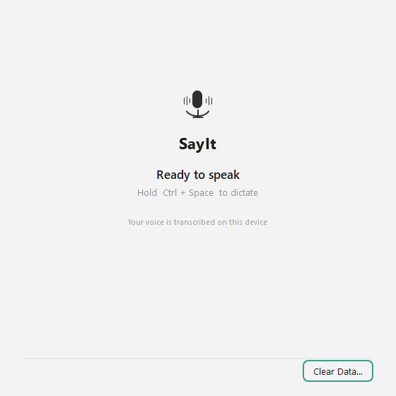
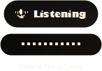
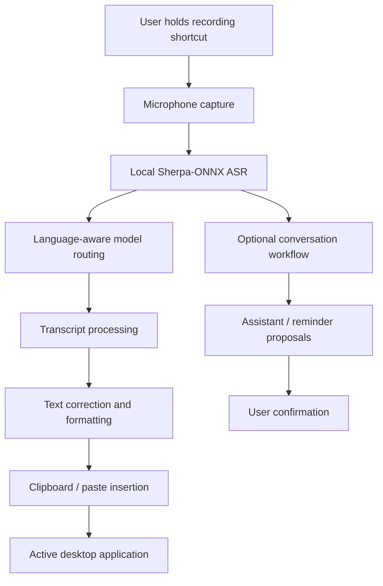

# SayIt

<div align="center">

### Your voice. Your words. Your workflow.

**Local-first desktop dictation and voice productivity.**

Speak naturally, convert speech into text locally, manage notes and reminders, and work across your desktop without depending on cloud transcription.

[](https://github.com/VptrCipher/SayIt/releases/tag/v0.2.0)
[](#downloads)
[](#downloads)
[](#development)
[](LICENSE)
[](#privacy)

**[Download SayIt v0.2.0](https://github.com/VptrCipher/SayIt/releases/tag/v0.2.0)** · **[Official Website](https://vptrcipher.github.io/SayIt/)** · **[Report an Issue](https://github.com/VptrCipher/SayIt/issues)**



*Built by Rahul J, Noah J, and Pranav H.*

</div>

> [!IMPORTANT]
> **SayIt v0.2.0 is available for Windows x64 and Linux x86_64.**
>
> macOS builds exist in CI, but public macOS distribution is deferred until Developer ID signing, notarization, and native acceptance are completed. No macOS installer is included in v0.2.0.
>
> Linux AppImage build and automated smoke tests have passed. Full hands-on X11 and Wayland desktop acceptance remains in progress.

---

## What is SayIt?

SayIt is a local-first desktop voice-typing and productivity application.

It combines on-device speech recognition with configurable text processing, a conversational assistant, a voice widget, local notes, and persistent reminders.

The core dictation experience is simple:

1. Hold your global recording shortcut.
2. Speak naturally.
3. Release the shortcut.
4. SayIt transcribes your utterance on your computer.
5. The resulting text is processed and inserted into your active application.

Beyond dictation, SayIt provides a focused assistant for conversational interactions and reminder management, along with tools for capturing notes and organizing spoken information.

**No cloud transcription account or API key is required for core dictation.**

## Why SayIt?

| Principle | What it means |
|---|---|
| Local-first | Speech recognition runs on your own machine using Sherpa-ONNX. |
| Desktop-wide | Dictated text can be inserted into applications that support clipboard paste. |
| Multilingual | English, Hindi, and Kannada recognition with language-aware model routing. |
| Configurable | Customize vocabulary, snippets, shortcuts, and formatting profiles. |
| Explainable | Local correction rules are deterministic and can be disabled. |
| Privacy-conscious | Cloud enhancement and saved history are opt-in. |
| Productive | Use voice, notes, conversational interactions, and reminders in one desktop application. |

## Features

### 1. Push-to-talk voice typing

- Configurable global keyboard shortcut.
- Default shortcut: `Ctrl + Space`.
- Hold to record and release to transcribe.
- On-device speech recognition.
- Clipboard-based text insertion.
- `Esc` cancellation for active recording and transcription.
- Visible Ready, Recording, Processing, and Error states.
- Persistent settings and custom-hotkey restoration.



### 2. Multilingual speech recognition

SayIt supports three dictation languages through compatible local recognition models.

| Language | Model | Role |
|---|---|---|
| English | NVIDIA Parakeet TDT 0.6B v2 INT8 | Default, faster English recognition |
| English | Whisper Small | Alternative, higher-accuracy-oriented model |
| Hindi | IndicConformer Hindi INT8 | Hindi recognition |
| Kannada | IndicConformer Kannada INT8 | Kannada recognition |

Language-aware routing prevents Hindi or Kannada sessions from silently falling back to an English-only recognizer.

### 3. Intelligent text processing

SayIt includes a deterministic transcript-processing layer designed to improve dictated text without unnecessarily rewriting ordinary speech.

Capabilities include:

- Technical terminology normalization.
- Custom vocabulary and preferred spellings.
- Context-aware formatting profiles.
- Text snippets and expansion.
- Developer-oriented identifier formatting.
- Explicit voice editing and correction commands.
- Smart structure commands such as new lines and enumerations.
- Protected application zones that can block recording before audio capture.

Examples of terminology normalization:

| Spoken input | Possible output |
|---|---|
| git hub | GitHub |
| ci slash cd | CI/CD |
| docker compose | Docker Compose |

These transformations are rule-based and can be configured or disabled.

### 4. Conversational assistant

SayIt includes a dedicated assistant panel supporting typed and voice-based conversational input.

Its focused productivity capabilities include:

- Conversational input and responses.
- Voice input through the existing recording and transcription pipeline.
- Reminder creation and management.
- Clarification when a request is ambiguous.
- Proposed actions with explicit confirmation before scheduling reminders.
- Correction of reminder titles and dates.
- Reminder listing, rescheduling, snoozing, and cancellation.

Example:

**You:** Remind me about a meeting tomorrow at 10 AM.

**SayIt:** Creates a reminder proposal for your review.

You can confirm or dismiss the proposal before it becomes an active reminder.

The assistant is designed around controlled actions, not unrestricted autonomous execution.

### 5. Voice Widget

A persistent desktop widget provides quick access to recording and note-taking.

- Draggable desktop placement.
- Record and stop controls.
- Recording-state visibility.
- Escape-to-cancel support.
- Quick access to Notes.
- Dictate-to-Note routing.

Dictate-to-Note is disabled by default. Normal dictation continues inserting text into the foreground application unless you explicitly enable note routing.

### 6. Notes panel

Capture and organize information without switching applications.

- Standalone docked Notes panel.
- Local autosave.
- Persistence across application restarts.
- Dictation-to-note support.
- Separate from ordinary foreground text insertion.

Notes are stored locally and are not automatically sent to a cloud service.

### 7. Reminder management

SayIt provides a persistent reminder system with:

- Natural-language reminder proposals.
- Explicit confirmation before scheduling.
- Local persistence.
- Rescheduling and renaming.
- Snoozing.
- Completion and cancellation.
- Desktop notification integration where supported.

**Important:** SayIt must be running to deliver reminders at their scheduled times. Overdue reminders are reconciled when the application starts again; SayIt is not an always-running operating-system background service.

### 8. Local-first intelligence

The intelligence layer adds structured processing around the speech-recognition pipeline.

It includes:

- Context-aware formatting.
- Developer mode.
- Snippet expansion.
- Remember Correction with explicit user approval.
- Safe Zones.
- Voice Edit and Backtrack.
- Smart Structure.
- Explicit personalization.

The correction pipeline does not require an LLM or cloud connection.

---

## How SayIt works



SayIt processes a completed utterance after the recording shortcut is released. It does not continuously transcribe speech in real time.

The production-validated recognition path uses CPU inference. CUDA, DirectML, and Vulkan are experimental research directions, not supported end-to-end production backends.

## Downloads

**Latest release: [SayIt v0.2.0](https://github.com/VptrCipher/SayIt/releases/tag/v0.2.0)**

### Windows x64

| Installer | Download | Description |
|---|---|---|
| On-demand | [SayIt-Setup-x64.exe](https://github.com/VptrCipher/SayIt/releases/download/v0.2.0/SayIt-Setup-x64.exe) | Smaller installer. Speech models are downloaded when needed. |
| Full Offline | [SayIt-Setup-x64-Offline.exe](https://github.com/VptrCipher/SayIt/releases/download/v0.2.0/SayIt-Setup-x64-Offline.exe) | Includes four validated INT8 speech models. |

**The Full Offline Windows installer includes:**

1. English Fast — Parakeet TDT 0.6B v2 INT8.
2. English alternative — Whisper Small INT8.
3. Hindi — IndicConformer Hindi INT8.
4. Kannada — IndicConformer Kannada INT8.

The bundled models are loaded from installation resources and are not duplicated into the per-user model cache.

### Linux x86_64

| Package | Download | Description |
|---|---|---|
| AppImage | [SayIt-0.2.0-Linux-x86_64.AppImage](https://github.com/VptrCipher/SayIt/releases/download/v0.2.0/SayIt-0.2.0-Linux-x86_64.AppImage) | Packaged desktop application. Models are downloaded when needed. |

Run the AppImage:

```bash
chmod +x SayIt-0.2.0-Linux-x86_64.AppImage
./SayIt-0.2.0-Linux-x86_64.AppImage
```

### macOS

macOS is not a public download target for v0.2.0.

Native arm64 and Intel build jobs have passed packaging CI, but public distribution remains deferred pending Apple Developer ID signing, notarization, and native acceptance.

### Checksums

The release contains:

- [`checksums.txt`](https://github.com/VptrCipher/SayIt/releases/download/v0.2.0/checksums.txt)
- [`release-manifest.json`](https://github.com/VptrCipher/SayIt/releases/download/v0.2.0/release-manifest.json)
- Individual `.sha256` checksum files.

Verify your downloaded installer before running it.

**Windows PowerShell:**

```powershell
Get-FileHash .\SayIt-Setup-x64.exe -Algorithm SHA256
```

**Linux:**

```bash
sha256sum SayIt-0.2.0-Linux-x86_64.AppImage
```

Compare the resulting hash with the corresponding value in `checksums.txt` or the file-specific checksum.

---

## Installation and first use

### Windows

1. Download the on-demand or Full Offline installer.
2. Run the installer and complete setup.
3. Launch SayIt.
4. Configure your microphone and preferred language.
5. Select a compatible speech-recognition model if needed.
6. Place your cursor in an application that accepts text input.
7. Hold `Ctrl + Space`, speak, and release.

Use the Full Offline installer when you want all four supported speech models available without downloading those model weights separately.

### Linux

1. Download the AppImage.
2. Make the file executable.
3. Launch the application.
4. Configure the microphone, language, model, and hotkey.
5. Grant or enable the desktop permissions needed for global input where applicable.

Speech model downloads require network access the first time. Previously downloaded models can subsequently be used locally.

---

## Privacy

Privacy is a core design principle of SayIt.

| Component | Default behavior |
|---|---|
| Speech recognition | Runs locally |
| Microphone audio for core ASR | Not sent to a cloud transcription service |
| Cloud transcript enhancement | Disabled |
| Transcript history | Disabled |
| Conversation history | Disabled |
| Notes | Stored locally |
| Reminders | Stored locally |
| Vocabulary and snippets | User-controlled |
| Telemetry | No project-added analytics or telemetry |

### Optional cloud enhancement

SayIt can optionally integrate with local or remote language-model providers for transcript-text enhancement.

When a remote provider is explicitly enabled and configured, transcript text can be sent to that provider.

This is separate from core speech recognition. Raw microphone audio is not sent for cloud transcription by this feature.

### Offline behavior

The Full Offline Windows installer bundles all four speech models, allowing speech recognition with those models without a separate model download.

The smaller Windows installer and Linux AppImage obtain speech models on demand.

Optional remote enhancement requires an internet connection and a configured provider.

SayIt should therefore be understood as a local-first application, rather than a claim that every configuration and feature is permanently offline.

---

## Platform support

| Platform | Distribution status | Validation |
|---|---|---|
| Windows x64 | Published | Installer builds, offline-model integrity, and Windows notification delivery tested |
| Linux x86_64 | Published | AppImage build, packaged launch smoke test, and artifact validation passed; hands-on X11/Wayland acceptance remains pending |
| macOS Apple Silicon | Not publicly distributed | Native CI packaging passed; signing, notarization, and interactive acceptance pending |
| macOS Intel | Not publicly distributed | Native CI packaging passed; signing, notarization, and interactive acceptance pending |

### Linux desktop notes

**X11**

The current hotkey path uses `pynput`. Clipboard insertion uses available system utilities such as `xclip` or `xsel`.

**Wayland**

SayIt uses the GlobalShortcuts portal where supported by the desktop environment.

Some Wayland compositors restrict synthetic keyboard input. When paste automation is unavailable, SayIt keeps the transcript available on the clipboard and asks the user to paste it manually.

Actual behavior can vary by compositor and desktop environment. Full interactive Linux acceptance has not yet been completed for every supported session.

### macOS notes

Native builds exist for Apple Silicon and Intel, but v0.2.0 does not distribute macOS installers.

A future public macOS release requires:
- Developer ID Application signing.
- Hardened Runtime and appropriate entitlements.
- Apple notarization.
- Stapling and Gatekeeper validation.
- Real microphone, Accessibility, hotkey, clipboard, and Notification Center testing.

---

## Known limitations

- Dictation is utterance-based, not streaming transcription.
- CPU is the validated production inference backend.
- GPU acceleration is experimental.
- First-time model acquisition requires network access unless the chosen model is bundled in the Windows Full Offline installer.
- Linux global hotkeys and clipboard insertion can vary between X11 and Wayland.
- Some applications restrict simulated paste or clipboard interaction.
- Reminders require SayIt to be running for on-time notification delivery.
- macOS installers are not available in v0.2.0.
- Linux hands-on desktop acceptance remains outstanding.

---

## Troubleshooting

### The hotkey does not work

- Confirm SayIt is running.
- Check that another application is not using the same shortcut.
- Verify the configured shortcut in Settings.
- On Linux, identify whether the session is X11 or Wayland and check the desktop's global-shortcut permissions.

### SayIt does not transcribe

- Confirm microphone access.
- Check the selected language and compatible model.
- Verify that the model has completed downloading, unless it is bundled.
- Check available system memory and storage.

### Transcribed text is not inserted

- Focus a normal editable text field.
- Check clipboard availability.
- On Linux X11, verify `xclip` or `xsel` availability.
- Under Wayland, manual paste may be required when synthetic paste is restricted.

### Why does the smaller installer download models?

The on-demand installer keeps the initial download smaller. Speech-recognition weights are obtained when required.

The Full Offline Windows installer includes all four intended models inside the installation payload.

### Why did a reminder not appear?

Check that SayIt is running, the reminder is active, and desktop notifications are enabled. Operating-system notification settings such as Do Not Disturb can suppress visible banners.

For an unresolved issue, open a [GitHub issue](https://github.com/VptrCipher/SayIt/issues). Include your OS, desktop session where relevant, selected model, and reproducible steps. Do not include private transcripts, credentials, or access tokens.

---

## Technology stack

| Layer | Technology |
|---|---|
| Application language | Python 3.12+ |
| Desktop interface | PySide6 / Qt |
| Speech recognition | Sherpa-ONNX |
| Models | Parakeet, Whisper, IndicConformer |
| Audio processing | sounddevice, NumPy |
| Global input | pynput and platform-specific hotkey backends |
| Text insertion | Clipboard integration and OS-specific paste |
| Data validation | Pydantic |
| Optional LLM integration | LiteLLM and compatible local/remote providers |
| Windows packaging | Briefcase + Inno Setup |
| Linux packaging | Briefcase + AppImage |
| macOS packaging | Briefcase + native DMG tooling |
| Testing | pytest, pytest-qt |
| CI/CD | GitHub Actions |
| Website | GitHub Pages |

---

## Development

### Prerequisites

- Python 3.12 or newer.
- [uv](https://docs.astral.sh/uv/).
- A supported desktop operating system.
- Microphone access for actual dictation testing.

### Clone and install

```bash
git clone https://github.com/VptrCipher/SayIt.git
cd SayIt

uv sync --frozen
```

### Run SayIt

```bash
uv run python -m sayit
```

### Run tests

```bash
uv run pytest -m "not slow"
```

### Project structure

```text
SayIt/
├── .github/
│   └── workflows/           # CI and release workflows
├── docs/                    # Documentation and screenshots
├── icons/                   # Application icons
├── scripts/                 # Build and model utilities
├── src/
│   └── sayit/
│       ├── core/
│       │   ├── asr/          # Speech recognition and models
│       │   ├── conversation/ # Conversational assistant
│       │   ├── reminders/    # Reminder engine and notifications
│       │   └── intelligence/ # Local text-processing pipeline
│       ├── ui/               # Desktop interface
│       └── utils/            # Platform capabilities
├── tests/                   # Automated test suite
├── website/                 # Product website and download center
├── installer.iss            # Windows on-demand installer
├── installer-offline.iss    # Windows Full Offline installer
├── pyproject.toml           # Dependencies and packaging
├── uv.lock                  # Locked dependencies
└── CHANGELOG.md             # Version history
```

---

## Release history

See [CHANGELOG.md](CHANGELOG.md) for the complete development and release history.

### v0.2.0

- Unified local-first dictation improvements.
- English, Hindi, and Kannada recognition.
- Four-model Full Offline Windows installer.
- Conversational assistant and voice input.
- Voice Widget and Notes panel.
- Persistent reminder management.
- Windows WinRT reminder notifications.
- Platform capability abstraction for Windows, Linux, and macOS.
- Linux AppImage distribution.
- Native macOS build pipeline, with public distribution deferred.
- Expanded automated test coverage and build-integrity validation.

**Published platforms:** Windows x64 and Linux x86_64.

**Deferred:** Public macOS distribution and full native Linux desktop acceptance.

---

## License and third-party acknowledgements

SayIt's application source is distributed under the [MIT License](LICENSE).

Speech models, runtime dependencies, and bundled third-party components retain their respective licenses. Review [THIRD_PARTY_LICENSES.md](THIRD_PARTY_LICENSES.md) before redistribution or modification.

Key upstream projects:

- [Sherpa-ONNX](https://github.com/k2-fsa/sherpa-onnx) — local speech-recognition runtime.
- [NVIDIA Parakeet TDT 0.6B v2](https://huggingface.co/nvidia/parakeet-tdt-0.6b-v2) — English speech recognition.
- [OpenAI Whisper](https://github.com/openai/whisper) — alternative English recognition.
- [AI4Bharat](https://github.com/AI4Bharat) — Indic speech-recognition models.
- [PySide6 / Qt](https://www.qt.io/) — desktop interface.

---

<div align="center">

### Speak naturally. Stay in control.

**Local-first dictation for the way you work.**

[Download SayIt v0.2.0](https://github.com/VptrCipher/SayIt/releases/tag/v0.2.0) · [Official Website](https://vptrcipher.github.io/SayIt/) · [GitHub Repository](https://github.com/VptrCipher/SayIt)

</div>
