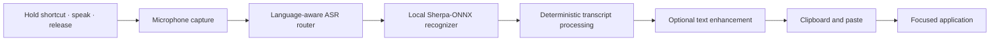

<div align="center">

# SayIt

### Your voice. Your words. Typed anywhere.

**Local-first, push-to-talk desktop dictation for Windows and Linux.**  
Hold a shortcut, speak, release — SayIt transcribes on your computer and inserts the result at your cursor.

[](https://github.com/VptrCipher/SayIt/releases/tag/v0.2.0)
[](#downloads)
[](#downloads)
[](LICENSE)
[](#privacy-first-by-default)

**[Download v0.2.0](https://github.com/VptrCipher/SayIt/releases/tag/v0.2.0)** · **[Official website](https://vptrcipher.github.io/SayIt/)** · **[Report an issue](https://github.com/VptrCipher/SayIt/issues)**


*Built by Rahul J, Noah J, and Pranav H.*

</div>

> [!IMPORTANT]
> **v0.2.0 is available for Windows x64 and Linux x86_64.** macOS downloads are **not currently available**. No `.dmg` is published for this release. Linux builds pass automated checks, but hands-on X11/Wayland acceptance for v0.2.0 is still pending.

## Why SayIt?

Most voice typing tools force a choice between convenience and control. SayIt is designed to fit into the apps you already use, with local speech recognition and explicit, configurable text processing.

- **Type across your desktop.** Dictate into editors, email, chats, documents, browser text boxes, and other applications that accept paste input.
- **Keep speech recognition on-device.** Sherpa-ONNX processes your audio locally after you finish speaking.
- **Speak in English, Hindi, or Kannada.** Choose a compatible local recognition model for the language you want to dictate.
- **Get useful technical text.** Deterministic rules can normalize terms such as `GitHub`, `Docker`, and `CI/CD`, as well as clearly spoken structured expressions.
- **Make it yours.** Customize vocabulary, snippets, hotkeys, and formatting profiles rather than depending on hidden automatic learning.
- **Control your data.** Cloud transcript enhancement and saved transcript history are disabled by default.

SayIt is **dictation software**, not a conversational voice assistant, streaming captioning service, or autonomous agent.

## Downloads

**Latest documented release: [v0.2.0](https://github.com/VptrCipher/SayIt/releases/tag/v0.2.0)**

| Platform | Download | What to choose |
|---|---|---|
| **Windows x64** | [On-demand installer — `SayIt-Setup-x64.exe`](https://github.com/VptrCipher/SayIt/releases/download/v0.2.0/SayIt-Setup-x64.exe) | Smaller download; may retrieve installation components as needed. |
| **Windows x64** | [Offline installer — `SayIt-Setup-x64-Offline.exe`](https://github.com/VptrCipher/SayIt/releases/download/v0.2.0/SayIt-Setup-x64-Offline.exe) | Larger installer for offline application setup. Speech models are still separate downloads. |
| **Linux x86_64** | [AppImage — `SayIt-0.2.0-Linux-x86_64.AppImage`](https://github.com/VptrCipher/SayIt/releases/download/v0.2.0/SayIt-0.2.0-Linux-x86_64.AppImage) | Self-contained AppImage; Linux desktop integration varies. |
| **macOS** | **Not available** | Signing, notarization, and native acceptance remain pending. |

The release also contains [`checksums.txt`](https://github.com/VptrCipher/SayIt/releases/download/v0.2.0/checksums.txt), individual `.sha256` files, and a `release-manifest.json`. Downloads come from the official GitHub release; the website's download page uses the published manifest.

> **“Offline installer” is not the same as “offline from first launch.”** SayIt downloads speech model weights separately on first selection/use. After a model has been downloaded, core speech recognition can run without an internet connection.

### Verify your download

Compare the SHA-256 hash of your downloaded file with the value in the release's `checksums.txt` (or its matching `.sha256` file).

**Windows PowerShell**

```powershell
Get-FileHash .\SayIt-Setup-x64.exe -Algorithm SHA256
```

**Linux**

```bash
sha256sum SayIt-0.2.0-Linux-x86_64.AppImage
```

See the [v0.2.0 release page](https://github.com/VptrCipher/SayIt/releases/tag/v0.2.0) for the published values. Do not use a download whose checksum does not match.

## Quick start

1. **Install SayIt.** On Windows, run your chosen installer. On Linux, download the AppImage, make it executable, and launch it:

   ```bash
   chmod +x SayIt-0.2.0-Linux-x86_64.AppImage
   ./SayIt-0.2.0-Linux-x86_64.AppImage
   ```

2. **Set up your microphone and language.** Use the first-run setup to configure audio input, a recognition model, and your shortcut. An internet connection is needed to download a model for the first time.
3. **Place your cursor** inside an application where you want to type.
4. **Hold `Ctrl + Space`** (the default shortcut), speak, and release. SayIt transcribes the finished utterance, applies your enabled processing rules, and inserts the text.
5. **Press `Esc` to cancel** an active recording or transcription when needed.

You can change the shortcut and enabled processing features in Settings. An account or API key is **not required** for core local dictation.

<div align="center">


&nbsp;&nbsp;


</div>

## Features

| Capability | What it does |
|---|---|
| **Global push-to-talk** | Configurable shortcut, system tray, visible recording/processing states, and cancellation. |
| **Local multilingual ASR** | English, Hindi, and Kannada models with language-aware routing. |
| **Transcript intelligence** | Conservative local corrections for technical terminology and structured text. |
| **Custom vocabulary** | User-controlled mappings for names, specialist terms, and preferred spelling. |
| **Text snippets** | Expand configured spoken triggers into literal saved text. |
| **Formatting profiles** | Different formatting behavior for contexts such as Developer, Email, Chat, Notes, or Prompt. |
| **Voice editing** | Supported explicit corrections and backtracking phrases, subject to rule matching. |
| **Safe Zones** | Configured protected apps can block recording before capture. |
| **Opt-in enhancement** | Optional local/remote LLM transcript enhancement, separate from speech recognition. |
| **Privacy controls** | Configurable history, data management, and opt-in behavior. |

Not every application handles synthetic paste or global shortcuts identically. Some advanced features and language/model combinations need additional testing on individual machines.

## How it works



SayIt processes **one completed utterance at a time**. Recognition begins after the recording shortcut is released; it does not continuously transcribe words mid-sentence.

The recognition engine runs on-device. Its validated production path is **CPU inference**. CUDA, DirectML, and Vulkan are experimental research directions and should not be assumed to provide supported end-to-end GPU transcription.

## Languages and models

| Language | Model | Availability |
|---|---|---|
| English | **NVIDIA Parakeet TDT 0.6B v2 INT8** | Default English recognizer |
| English | **Whisper Small** | Alternative model |
| Hindi | **IndicConformer Hindi INT8** | Selectable Hindi recognizer |
| Kannada | **IndicConformer Kannada INT8** | Selectable Kannada recognizer |

Speech model weights are downloaded **on demand** and are not included in the published installers. Choose the language and model in Settings; routing checks language compatibility instead of silently falling back to an English-only model for Hindi or Kannada sessions.

Recognition quality and latency vary with the microphone, environment, accent, hardware, selected model, and spoken material.

## Privacy: first by default

| Action | Default behavior |
|---|---|
| Microphone transcription | Runs on your device through Sherpa-ONNX |
| Cloud-based transcript enhancement | **Off** |
| Saved transcript history | **Off** |
| Custom vocabulary and snippets | Locally configured and user-controlled |
| Usage analytics / telemetry | No project-added analytics or telemetry |
| Speech model downloads | Network required only to obtain selected models |

When you **explicitly enable remote enhancement**, transcript **text** can be sent to your configured provider. Core speech recognition does not require sending microphone audio to a cloud transcription service. Optional remote providers and model downloads mean SayIt should not be described as *fully offline in every configuration*.

The deterministic correction layer can be disabled. It is not a remote LLM: it applies explainable rules without reading screenshots or the content of other applications.

## Platform support and known limitations

| Platform | v0.2.0 status | Important notes |
|---|---|---|
| **Windows x64** | **Published** | Primary desktop target; two installers. Clean-machine tests are recommended. |
| **Linux x86_64** | **Published; partially validated** | CI build and packaged smoke test passed. Real-device X11/Wayland hotkey, clipboard, and notification acceptance remains outstanding. |
| **macOS (Intel / Apple Silicon)** | **No public download** | CI can build macOS on non-v0.2.0 runs, but Developer ID signing, notarization, and native distribution acceptance are outstanding. |

Other limitations:

- **Wayland behavior can vary.** Global hotkey capture may be restricted; X11 sessions generally offer a more predictable environment for the current input approach.
- **Linux clipboard insertion may require `xclip`.** Install it through your distribution's package manager if clipboard insertion fails under X11.
- **Some apps block simulated paste.** The transcript may need to be pasted manually when insertion is restricted.
- **Speech recognition is utterance-based**, not live streaming or translation.
- **GPU backends are not production-supported** for full end-to-end transcription.
- **Windows security warnings may appear** for unsigned packages. Verify you obtained the installer from the official release and validate its checksum before deciding whether to run it.
- **Enterprise-policy components are foundational**, not a complete hosted device-management, identity, or compliance platform.

## Troubleshooting

<details>
<summary><strong>Nothing happens when I hold the shortcut.</strong></summary>

Check that SayIt is running in the system tray, your microphone is available, and another program has not claimed the same shortcut. Try changing the shortcut in Settings. On Linux, check whether you are running X11 or Wayland; global shortcut capture can be restricted under Wayland.

</details>

<details>
<summary><strong>The model will not download or transcription does not start.</strong></summary>

Check your network connection for first-time model downloads, available storage, the selected dictation language, and whether the model is fully downloaded. A previously downloaded local model can run without network access.

</details>

<details>
<summary><strong>SayIt recognized my words but did not type them.</strong></summary>

Focus a normal text field and try again. Some applications or privilege boundaries prevent simulated paste. Check clipboard access and, for Linux X11, whether `xclip` is installed. If available, copy the transcript manually rather than repeating a long recording.

</details>

<details>
<summary><strong>Why does the offline installer still need a model download?</strong></summary>

The offline Windows installer packages the application installation payload. Speech recognition models are optional, comparatively large, and acquired separately on first use. The chosen model can subsequently run locally.

</details>

For reproducible issues, include your OS/version, X11 or Wayland where relevant, installer name, selected recognition model, and the steps that failed. **Do not post private transcripts, access tokens, or credentials** in public issues.

**[Open an issue →](https://github.com/VptrCipher/SayIt/issues/new)**

## Reference performance

An earlier warm-model Windows benchmark on an AMD Ryzen 5 4600G, using Parakeet TDT 0.6B v2 INT8 on CPU, recorded the following across 60 fixed-clip runs:

| Measurement | Median (p50) | p95 |
|---|---:|---:|
| ASR inference | ~739 ms | ~1,795 ms |
| Stop-to-text processing (ASR + local intelligence) | ~836 ms | ~2,049 ms |

The model was already loaded. These measurements **exclude GUI rendering and final clipboard insertion**, are **not fresh v0.2.0 benchmarks**, and are not performance guarantees. Real-world performance depends on CPU, recording duration, language, and model.

## Development

### Prerequisites

- Python **3.12+**
- [`uv`](https://docs.astral.sh/uv/)
- A supported desktop environment, microphone, and any OS permissions required for input capture

### Run from source

```bash
git clone https://github.com/VptrCipher/SayIt.git
cd SayIt
uv sync --frozen
uv run python -m sayit
```

### Tests

```bash
uv run pytest -m "not slow"
```

The project pins `sherpa-onnx` and `sherpa-onnx-core` together at **1.13.8** in the documented dependency configuration. Treat upgrades to native ASR dependencies as compatibility-sensitive.

### Technology stack

- **App & UI:** Python, PySide6 / Qt
- **Recognition:** Sherpa-ONNX; Parakeet, Whisper, IndicConformer models
- **Audio & input:** sounddevice, NumPy, pynput
- **Text insertion:** OS clipboard integration and pyperclip
- **Configuration / optional enhancement:** Pydantic, LiteLLM, optional local Ollama-compatible providers
- **Build / delivery:** uv, Briefcase, Inno Setup, GitHub Actions, GitHub Releases, GitHub Pages
- **Testing:** pytest, pytest-qt, website tests

### Repository layout

```text
SayIt/
├── .github/workflows/    # CI, release, and website deployment workflows
├── docs/                 # Documentation and screenshots
├── src/sayit/            # Desktop application and transcription pipeline
├── tests/                # Automated Python tests
├── website/              # Public download and product website
├── scripts/build.py      # Desktop packaging driver
├── installer.iss         # Windows installer definition
├── pyproject.toml        # Project dependencies and app packaging settings
└── CHANGELOG.md          # Release history
```

## v0.2.0 release verification

The v0.2.0 release was published from the merge commit [`827eb158`](https://github.com/VptrCipher/SayIt/commit/827eb1585da7788c0ee5cb3e66c3fa972679aae9) on `main`.

- **CI result:** automated tests, Windows installers, Linux AppImage, and release publication succeeded in the [tag-triggered workflow](https://github.com/VptrCipher/SayIt/actions/runs/39994226926).
- **macOS:** deliberately skipped **only** for the exact `v0.2.0` tag; no unsigned or unnotarized DMG was released. Other refs retain macOS CI and signing gates.
- **Artifacts:** Windows, Windows on-demand, and Linux manifest entries; `checksums.txt` and per-file hashes included.
- **Website:** redeployed after publication so the downloads reflect the new release.
- **Validation caveat:** Linux real-device acceptance is still pending; passing build/smoke tests is not the same as verifying all desktop environments.

**[Read the changelog](CHANGELOG.md)** · **[Inspect the release](https://github.com/VptrCipher/SayIt/releases/tag/v0.2.0)**

## Contributing

Bug reports, reproducible test cases, documentation corrections, and focused pull requests are welcome. Before opening a PR, run the relevant tests and explain any platform-specific behavior. For changes that affect speech models, packaging, security, or privacy, include compatibility evidence and avoid widening production claims beyond what is tested.

## License and credits

SayIt's application source is distributed under the **[MIT License](LICENSE)**. Third-party models and dependencies retain their own licenses; refer to [`THIRD_PARTY_LICENSES.md`](THIRD_PARTY_LICENSES.md) and the respective upstream projects.

- [Sherpa-ONNX](https://github.com/k2-fsa/sherpa-onnx) — on-device ASR runtime
- [NVIDIA Parakeet TDT 0.6B v2](https://huggingface.co/nvidia/parakeet-tdt-0.6b-v2) — default English recognizer
- [OpenAI Whisper](https://github.com/openai/whisper) — optional English recognition
- [PySide6 / Qt](https://www.qt.io/) — desktop UI

---

<div align="center">

**Private-by-default dictation. Your workflow, your words, your control.**

**[Get SayIt v0.2.0](https://github.com/VptrCipher/SayIt/releases/tag/v0.2.0)** · **[Explore the website](https://vptrcipher.github.io/SayIt/)**

</div>
